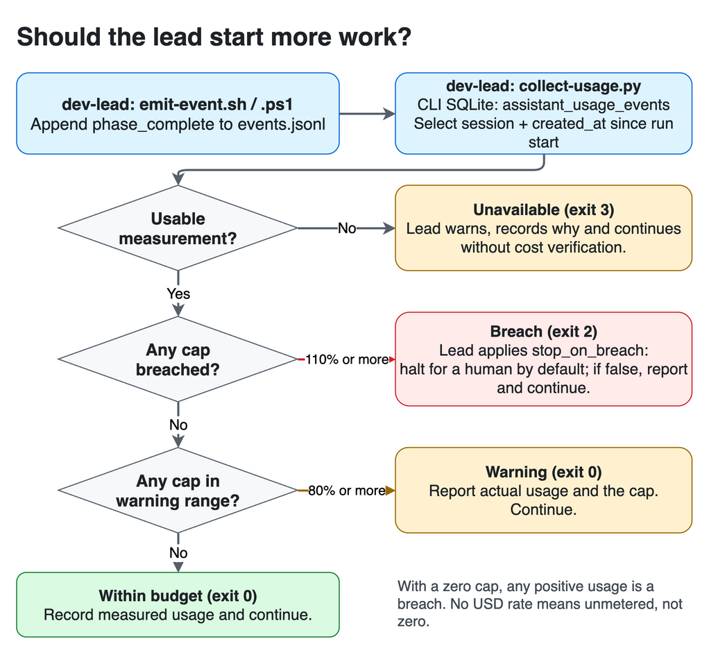

# When a run reaches its budget

The budget controls **the resources used to do the engineering work**, not the
hosting bill for the resulting application. It is a checkpoint, not a live
credit limiter: several specialists can finish work before the next check
detects an overrun.

## What gets measured

`dev-lead` loads `cost-budget` at intake. After each closed phase window and
again at completion, the lead explicitly calls the skill's Python collector.
It compares runtime measurements, not an agent's estimate, with the solution's
allowances.

| Profile field under `cost_envelope` | Compared with |
|---|---|
| `max_tokens_per_run` | Measured input plus output tokens for the run. |
| `max_aiu_per_run` | Measured AI units (AIU) for the whole run. |
| `max_aiu_per_phase` and `max_aiu_per_phase_overrides` | AIU accumulated for the **named** phase, using its override if present, otherwise the default. Returning to that phase does not reset it. |
| `max_usd_per_run` | Only enforceable with `usd_per_aiu`. Without a rate, USD is **unmetered** (`null`), not zero dollars. |
| `max_minutes_per_run` | Planning information only. It is not a timeout; concurrent call durations are not elapsed wall time. |

Direct author work counts under `implement`; a delegated author has a role
window such as `coding`. Read-only contributions share `research` or `plan`;
review lenses share `review-lead`. A per-role override is not independently
enforced on work with no separate window.

## Where the budget data comes from

| Input | Source | What the collector uses |
|---|---|---|
| **Usage** | The Copilot CLI writes model-call rows to the SQLite table `assistant_usage_events`, by default in `~/.copilot/session-store.db`. The collector opens it **read-only**. `--store` can select another store; otherwise `COPILOT_SESSION_STORE` overrides the default path. | Select rows for `--session-id` (defaults to `COPILOT_AGENT_SESSION_ID`). Use each row's `created_at`, `input_tokens`, `output_tokens` and `total_nano_aiu`. Total tokens are input plus output; AIU is summed nano-AIU divided by one billion. Reasoning and cache-read tokens are reported separately, not added again. |
| **Run and phase boundaries** | The lead persists the UTC `timestamp` of its `run_start` event as `run_started_at`. The run's `events.jsonl` supplies the timestamps of named `phase_start` / `phase_complete` pairs. | `--since` includes rows with `created_at` **at or after** `run_started_at`. `--event-log` assigns those rows to phases; it does not replace the run filter. Rows outside all phase windows still count toward the run total as unattributed usage. |
| **Limits and policy** | The consuming repository's `.github/solution-profile.yaml` → `cost_envelope`. | The lead passes configured caps and any USD rate to the collector. It reads the returned warnings/breaches and applies `stop_on_breach` itself. The profile contains **limits**, not observed spend. |

For a phase that opens at **10:00 UTC** and closes at **10:05 UTC**, a call
recorded at 10:00 belongs to it; a call at exactly 10:05 does not. Attribution
uses the row's `created_at`, not its duration. On retry or resume the lead
reuses the **original** run start, not today's date, the commit date or the
time it resumed. A valid session selection with no rows in a phase can yield
zero recorded usage; an unreadable store or invalid timestamp yields
**unavailable**, not zero.

## How the checkpoint decides



[Editable budget diagram](../assets/budget-checkpoint.drawio)

| Collector result | Lead's action |
|---|---|
| **Below 80%** of every positive cap | Continue. Record the measured result. |
| **At least 80%, below 110%** of a positive cap, with no breach | Report a warning and continue. Reaching exactly 100% is a warning, not yet the stop threshold. |
| **At least 110%** of any positive cap (exit `2`) | Record the breached metric, limit, actual and phase if applicable. With `stop_on_breach: true` (default), halt; the human can accept an overrun, change the allowance, or split the scope. With an explicit `false`, report the breach and continue. No automatic retry. |
| **Unavailable telemetry or invalid metering configuration** (exit `3`) | Warn, record the reason and continue without claiming cost verification. This is **neither a pass nor a measured breach**; do not invent zero usage. |

For example, a hypothetical **100 AIU phase cap** warns at 80 and breaches at
110, even if the run-wide cap has room. With an explicit **zero** cap, zero
usage is allowed and any positive usage breaches it. Token and AIU comparisons
do not need a dollar conversion.

At intake, `enabled: false` means cost gating is **disabled**, not passed.
A missing envelope blocks an external-project run; the documented internal,
experiment and template cases warn and proceed ungated. At completion the lead
attaches the collector result or an explicit unavailable/disabled state to
`run_complete`. A budget exception does not approve the task plan, a deployment,
or a pull request.

## Which script does what?

The lead calls [`emit-event.sh`](../../plugins/agile-agents-core/skills/run-event-log/scripts/emit-event.sh)
or [`emit-event.ps1`](../../plugins/agile-agents-core/skills/run-event-log/scripts/emit-event.ps1)
for `run_start` and each `phase_start` / `phase_complete` pair. The emitter
validates and appends a timestamped record to `.copilot-runs/<run-id>/events.jsonl`.
It **does not** measure usage or stop a worker. After closing the window, the
lead invokes [`collect-usage.py`](../../plugins/agile-agents-core/skills/cost-budget/scripts/collect-usage.py).
In this example, `cost_skill_dir` is the directory of the **loaded**
`cost-budget` skill, `events` is the current run's log path, and the caps
are resolved from the profile. For **run caps only**, when both token and AIU
limits are set, the call is:

```sh
python "$cost_skill_dir/scripts/collect-usage.py" \
  --since "$run_started_at" --event-log "$events" \
  --max-tokens "$run_token_cap" --max-aiu "$run_aiu_cap"
```

Omit an unset run cap, but keep an explicit zero. If the closed phase also
has an AIU limit, append **both** `--phase "$closed_phase"` **and**
`--max-phase-aiu "$phase_aiu_cap"` to that same call. With no phase limit,
omit **both** flags; passing one alone exits `3` before the run caps are
checked. Pass `--usd-per-aiu "$rate"` only when a rate is configured, and
`--max-usd "$run_usd_cap"` only when **both the USD cap and the rate** are set.

The collector returns totals, phase attribution, warnings and breaches as
JSON when measurement succeeds. At completion the lead attaches that
unaltered result, or the explicit unavailable/disabled state, to `run_complete`.

**Sources:** [budget policy](../../plugins/agile-agents-core/skills/cost-budget/SKILL.md),
[collector implementation](../../plugins/agile-agents-core/skills/cost-budget/scripts/collect-usage.py),
[event contract](../../plugins/agile-agents-core/skills/run-event-log/references/event-schema.json),
[budget decision](../adr/0004-cost-envelope-thresholds-and-stop-on-breach.md).
