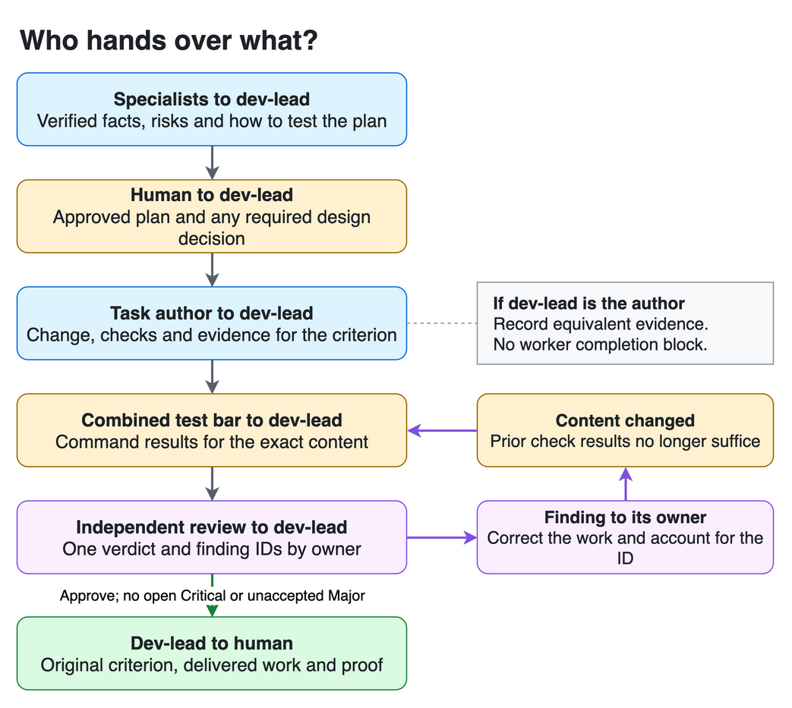

# Hand-offs and tracker integration

## Canonical hand-off blocks

`dev-lead` carries context between producers and consumers. A **sentinel** is
the fixed heading that tells the receiver which fields a delegated result must
contain. The heading alone is not the result: the lead reads the matching
schema and checks its fields against the task and its gate.

| Block | Producer → next decision | What the receiver needs |
|---|---|---|
| `BOOTSTRAP COMPLETE` | `bootstrapper` → lead at intake | Profile path, required fields, remaining gaps and `Ready for delivery`. A `no` blocks Research. |
| `RESEARCH CONTRIBUTION COMPLETE` | Eligible author disciplines → lead during Research and Plan refinement | Mode, verified facts, assumptions, risks, task input, verification approach and dissent. A contribution informs; it does not approve. |
| `ARCHITECTURE DESIGN COMPLETE` | `architect` → lead, then planner and author if design depth was needed | Chosen direction, binding decisions, constraints, alternatives, unresolved decisions and follow-on tasks. |
| `TASKS PLANNED` | `backlog-manager` → lead → human plan gate, when tracking is enabled | Linked provisional children, their criteria, and the approach recorded on the parent. |
| `IMPLEMENTATION COMPLETE` | `coding` → lead's per-task gate → reviewers | Changed behavior and the test that asserts it, actual build/test results and reasons for modifying existing tests. |
| `INFRASTRUCTURE COMPLETE` | `infrastructure` → lead's per-task gate → reviewers | Scope and preview, IaC validation, behavior-to-IaC-test evidence and changed-test accounting. |
| `ANALYSIS COMPLETE` | `data-scientist` → lead → `review-lead` → `data-reviewer`; also to a dependent author or human as needed | Forward the block for independent review even for negative results or when no model ships. `coding` receives the serving interface when applicable. |
| `REVIEW COMPLETE` | `review-lead` → lead → fixer or final reconciliation | Verdict, participating lenses, open severities and stable finding IDs grouped by owner. |

A missing or malformed block receives one corrective request; a second failure
stops the run. Field definitions live in the
[hand-off contracts](../../plugins/agile-agents-core/skills/read-repo-context/references/handoff-contracts.md).

## What crosses a phase boundary

[Editable handover diagram](../assets/delivery-handovers.drawio)

**Research to Plan.** The planner receives the original criteria, verified
facts, assumptions with their impact, constraints and unresolved questions.
The same author disciplines refine the draft. The lead reconciles **each
proposal**, not just each response. At approval the human sees every non-`none`
`Dissent:` verbatim and attributed to its specialist, each declined proposal
with the lead's reason stated separately, and how the tasks will be verified.
Reviewers do not help write this plan.

**Plan to author.** Dispatch one dependency-ready task: its criteria, approach,
chosen author, relevant profile facts, design constraints and verification
method. A delegated author returns the appropriate block above. If `dev-lead`
authors an approved application or IaC task itself, it records equivalent
evidence in the task record: **no worker sentinel and no `handoff_received`
event**. There is no separate testing hand-off.

**Verification to reviewers.** Send the original requirement, diff base, the
readable combined change (including contents of relevant untracked files),
each task's evidence and changed-test justifications, and the combined gate
results. A base-to-HEAD patch alone misses uncommitted work; hashes identify
what was checked but cannot show a reviewer what the change does.
Capture HEAD, staged and unstaged changes and hashes of relevant untracked
files before and after verification. A new file or an edit in the same commit
can invalidate evidence even when HEAD is unchanged.

**Review back to the author.** Each fixer gets only its finding IDs, locations
and proposed fixes. It accounts for every ID as `fixed`, `disputed` (with a
reason), or `not mine` (naming the owner). A fixer's assertion never closes a
finding: the lead re-routes misassigned work, reruns affected gates after
content edits, and sends current evidence to independent re-review. A
no-edit dispute can retain valid command evidence. [Review and completion](review.md)
explains when this loop stops.

## Tracker integration

The tracker is the source of truth for the plan. Only `backlog-manager` writes to
it, and the profile declares which tracker (`backlog.platform`, `backlog.url`).

Status uses a neutral vocabulary, mapped to your tracker's states:

| State | Set when |
|---|---|
| `in_progress` | Just before a task is dispatched |
| `implemented` | The task's gate passed; not yet verified against the requirement |
| `blocked` | A gate failed every retry, or a dependency is blocked |
| `done` | Only at completion, after requirement coverage is verified |

A failed status update warns and the run continues; a failed task *creation*
stops the run before approval. If the tracker has no `implemented` state,
the manager leaves the state as-is and comments; it does not close the item
early. With `backlog.create_tasks: false`, the same plan is approved inline,
without creating or mirroring tracker items.

## Run evidence

`dev-lead` alone emits structured events to `.copilot-runs/<run-id>/events.jsonl`
and collects measured usage with the cost-budget collector. See [budget
checkpoints](budget.md) for how the log's phase windows are used and what
happens when a measurement or rate is missing.
