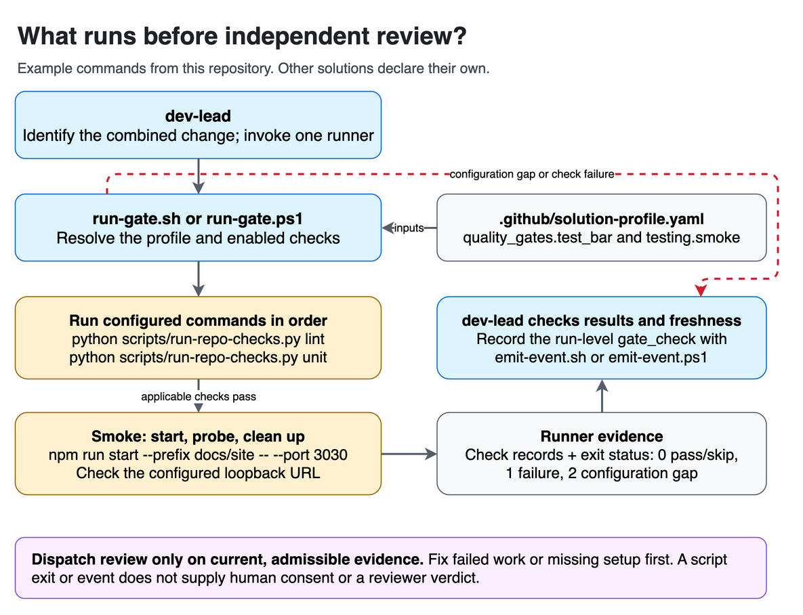

# Implement and quality gates

## One task at a time

Approved tasks run sequentially in dependency order. For each application or IaC
task, `dev-lead` either authors it directly — including its tests — or delegates
to `coding` or `infrastructure`. Analysis, modelling and evaluation always go to
`data-scientist`.

The author owns the tests. For application work, map each changed behavior to
the test that asserts it. For IaC, supply validation **and** the corresponding
IaC test, or the specific reason no executable test applies. Explain why the
old assertion was invalid whenever an existing test changes. Never weaken,
delete or skip tests to get green.

A per-task gate checks scope and the evidence appropriate to the task. For
analysis, that includes the method and result. A
delegated author returns a hand-off; a direct author records equivalent evidence
without a worker sentinel. An analysis task may legitimately conclude *no*;
its rigor is gated, never the direction of its answer.

## Deterministic test bar

Before any reviewer runs, `dev-lead` loads `test-bar-gate` and invokes its
bundled runner. The runner executes the solution's profile-enabled checks over
the combined diff, failing fast by default.
The order is **lint → type-check → unit tests → optional integration, coverage
and mutation checks → smoke**. Disabled checks are reported as skips. The
solution supplies the commands; core does not guess from the project language.

- Read the recorded reason as well as the exit status. A failing executed
  check (runner exit `1`) goes back to its author for at most three corrective
  retries, stopping sooner if a round reduces no failures. A missing executable
  can also produce runner exit `1` (`command_not_found`, child status `127`);
  surface the missing tool rather than treating it as a source defect.
- A missing enabled command in the profile or unresolved startup configuration
  is a configuration gap (exit `2`); stop rather than spending a source-fix retry.
- Smoke starts the declared process, probes its configured URL within a fixed
  deadline, and cleans up the process tree it owns. Reachability is not a test
  of application behavior. An evidenced *not applicable* is a skip only if it
  does not conflict with a configured smoke command or URL. A conflict or
  *undetermined* startup is a configuration gap. Exit `0` alone cannot
  distinguish pass from skip; read the check records.
- Gate evidence is tied to the exact content verified; later edits require
  re-verification.

The lead does not spend independent reviewer time on a failed required check.
The [runner contract](../../plugins/agile-agents-core/skills/test-bar-gate/SKILL.md)
describes its structured results. A declarative IaC-only diff with author-run
IaC tests can be inapplicable to the bar; infrastructure expressed in a
general-purpose language still runs it.

### Technical call path



[Editable technical gate diagram](../assets/technical-test-gate.drawio).
The diagram uses **this repository's commands** as an example, not commands a
consumer inherits. The two runner calls are alternatives, not sequential steps:

```sh
bash plugins/agile-agents-core/skills/test-bar-gate/scripts/run-gate.sh --profile .github/solution-profile.yaml
```

```powershell
pwsh -NoProfile -File plugins/agile-agents-core/skills/test-bar-gate/scripts/run-gate.ps1 -ProfilePath .github/solution-profile.yaml
```

These paths are from the **harness checkout**. In an installed plugin, the
lead resolves `scripts/run-gate.sh` or `scripts/run-gate.ps1` from the loaded
`test-bar-gate` skill's directory and invokes it from the **consuming repository
root**, against that repository's profile. It does not expect a copy of core
under the consumer's `plugins/` directory.

The [Bash runner](../../plugins/agile-agents-core/skills/test-bar-gate/scripts/run-gate.sh)
uses `yq`; the [PowerShell runner](../../plugins/agile-agents-core/skills/test-bar-gate/scripts/run-gate.ps1)
uses `powershell-yaml`. They read the same `quality_gates.test_bar` and
`testing.smoke` fields. Here they dispatch `python scripts/run-repo-checks.py
lint`, then `python scripts/run-repo-checks.py unit`, with disabled slots
reported explicitly. The configured smoke command starts the docs site on
loopback. On PowerShell, [`start-smoke.ps1`](../../plugins/agile-agents-core/skills/test-bar-gate/scripts/start-smoke.ps1)
helps the runner own the process tree; it does not replace the HTTP probe.

The runner emits per-check results to stdout or `COPILOT_EVENT_LOG`. Separately,
`dev-lead` records the **run-level** outcome with `emit-event.sh` or
`emit-event.ps1`, compares the verified content to the content being reviewed,
and decides whether to dispatch `review-lead`. Neither the runner nor the event
emitter can approve the plan, resolve a review finding or declare the
requirement delivered. [The gate matrix](index.md#who-enforces-a-gate)
identifies the owner of those decisions.

## Optional deploy-verify

When `infrastructure.deploy_verify: dev` is set, the feature branch is deployed
through the project's own pipeline to the first non-production environment, to
catch quota, policy and permission problems a plan cannot. It never targets
production or the final environment in the chain. The only candidate is
`environment_chain[0]`; the harness does not search later entries. A
prod-named first entry stops for human correction. A docs-only change or a
feature branch whose pipeline cannot reach dev skips with a reason.

The pipeline run must match the feature revision, and the non-mutating preview
after deployment must show no pending changes. Where authorized application
telemetry is available, inspect exception and failed-request counts **since
that deployment** to catch first-use failures. Missing access or measurements
leave that telemetry step unverified, not passed or failed. Quota, policy or a
missing role assignment stops deployment verification without a retry.

Next: [Review and completion](review.md).
