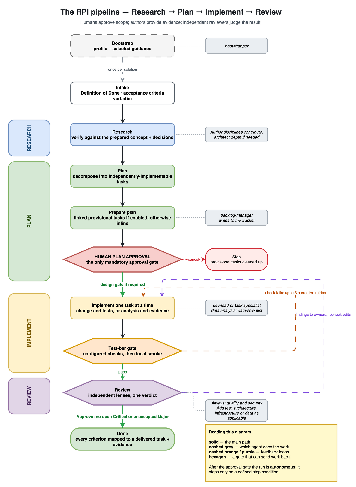
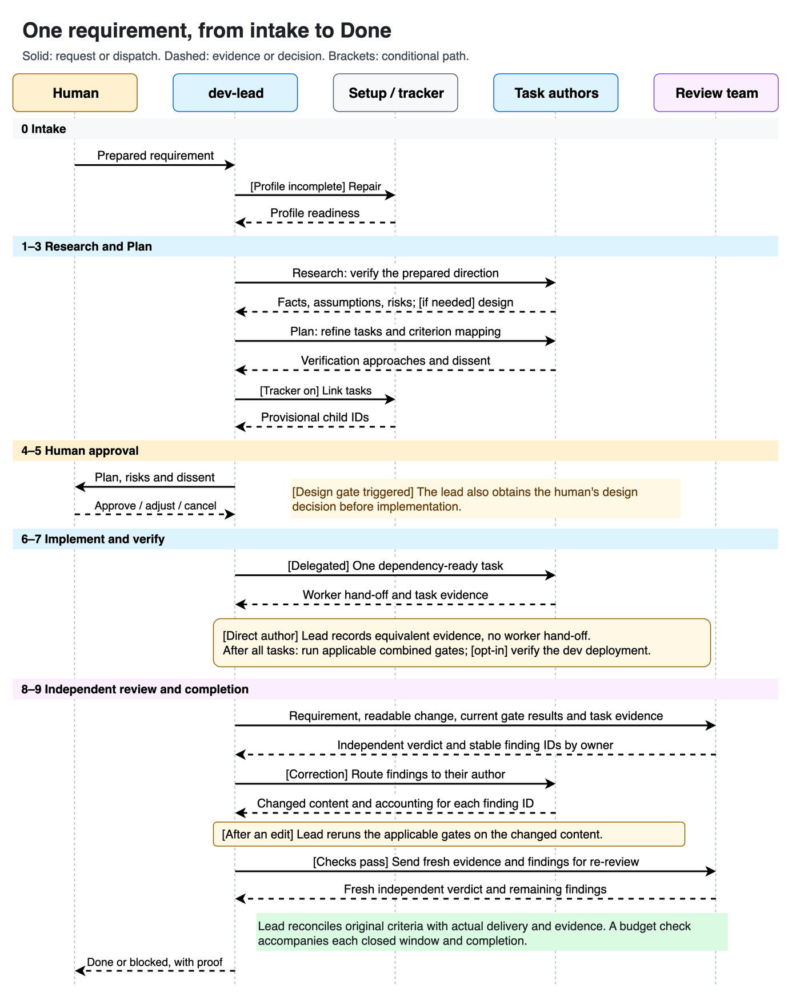

# Flow overview

`dev-lead` supervises one requirement through **Research → Plan → Implement →
Review**. Each stage has an entry condition, an owner and an exit gate; a failed
gate is retried with specific feedback within a fixed budget, then escalated to
you.

[Editable pipeline overview](../assets/rpi-pipeline.drawio)

| Stage | Phase | What happens | Owner |
|---|---|---|---|
| 0 | Intake | Profile check, Definition of Done, acceptance criteria, run id, cost envelope | `dev-lead` (`bootstrapper` if the profile is incomplete) |
| 1 | [Research](research.md) | Read-only verification against prepared concepts and decisions | `dev-lead`, `architect`; contributions from `coding`, `infrastructure`, `data-scientist` |
| 2–3 | [Plan](plan.md) | Decompose into tasks; optionally create linked tracker items | `dev-lead`, `backlog-manager`; refinement from the author specialists |
| 4–5 | [Approval](plan.md#plan-approval) | Mandatory plan approval; conditional design approval | you |
| 6–7 | [Implement](implement.md) | One task at a time, then the deterministic test bar | `dev-lead`, `coding`, `infrastructure`, `data-scientist` |
| 8–9 | [Review and Done](review.md) | Independent multi-lens review, then requirement coverage | `review-lead` and specialists, `dev-lead` |

## Sequence of a delivery run

[Open the editable sequence diagram](../assets/delivery-sequence.drawio).
Read top to bottom. Solid arrows request work; dashed arrows return evidence or
a decision. The support lane combines optional bootstrap and tracker work.
The author lane combines roles, **not** parallel implementation: only research,
refinement and review fan out. The stage table above is the text equivalent.
The [handover guide](handoffs.md) follows the corrective loop in detail.

## Who enforces a gate?

Start [`dev-lead`](../getting-started/first-requirement.md) with a requirement.
At a gate, the lead loads the relevant skill's instructions. **Loading a skill
does not execute its scripts.** For the test bar and budget it explicitly
invokes a helper bundled with the skill. For a human decision it calls
`ask_user`; for independent review it dispatches `review-lead`. There is no
single gate executable or background scheduler for all these steps.

Most gates do **not** filter evidence by date. A recent green build for a
different change is still the wrong build. The table identifies what makes
evidence current; only budget accounting uses a run-start timestamp to select
usage. Smoke and deployment polling use deadlines to **bound waiting**;
post-deployment telemetry, when available, has its own observation window.

| Gate and invocation | Source data | Which decision, revision or time counts? |
|---|---|---|
| **Intake** — the lead reads the profile and requirement; invokes `bootstrapper` if repair is needed. | The source requirement, its stated criteria, the [six required profile fields](../getting-started/bootstrap.md#the-six-required-fields), and parent item if tracking is enabled. | The inputs for **this requirement**. Missing required facts block Research. Derived criteria need human confirmation at plan approval. |
| **Research and refinement** — the lead asks eligible specialists to contribute read-only. | Prepared decisions, source evidence, assumptions, contribution blocks or recorded skips, proposed tasks and dissent. | Cite each load-bearing fact's source and applicable version, region or date; label unverified assumptions. There is no universal expiry date. Separately, compare HEAD and working-tree status before and after each round to check it stayed read-only. |
| **Tracker creation** — when enabled, the lead delegates to `backlog-manager`. | Parent ID, reconciled tasks and the tracker response: linked provisional child IDs and approach comment. | Require the **actual links for this plan** before approval; creation failure stops the run. Inline planning uses the task list without tracker writes. |
| **Plan and conditional design approval** — the lead presents each applicable decision via `ask_user`. | The presented plan, risks, criteria and dissent; for design, the architect's direction and gaps. The evidence is the human's **actual response**. | Approval is for the presented version. Adjust and present again, or stop on cancel. Neither a prior run's answer nor a log timestamp authorizes implementation. |
| **Per-task acceptance** — the lead checks a delegated hand-off or records equivalent direct-author evidence. | Approved task and constraints, changed behavior, test/validation results, changed-test justifications; for analysis, method and result. | The work and evidence for **that task**. A malformed result gets one correction. A negative result that invalidates dependent work requires a human scope decision. |
| **Combined test bar and smoke** — the lead invokes [one platform runner](implement.md#technical-call-path). | Profile commands, process exit status, per-check results and explicit skips; for smoke, the owned process and the response from the configured URL. | Match HEAD, staged/unstaged changes and relevant untracked content **before and after** checking. Smoke must answer within `testing.smoke.timeout_s`. Missing configuration or a failed required check prevents review. |
| **Dev deployment**, if enabled — the lead applies [`deploy-verify`](implement.md#optional-deploy-verify) through the solution's pipeline. | Pipeline outcome for the feature SHA and eligible environment, post-deploy preview, liveness evidence and applicable authorized telemetry. | Poll that run to a fixed deadline, including queue time. Inspect exception and failed-request counts **since that deployment**, not since the engineering run began. Unavailable telemetry is unverified. |
| **Independent review and re-review** — `review-lead` dispatches the applicable reviewers. | Original requirement, readable combined change, current test-bar results, author evidence and findings by ID. | The verdict must apply to the reviewed content. A correction that changes it needs fresh applicable checks before re-review. A fixer's claim alone does not close a finding. |
| **Done** — the lead reconciles every original criterion. | Delivered task or existing behavior and its proof, the independent verdict and outstanding findings. | Require an approving verdict on current content, no open Critical or unaccepted Major and no uncovered criterion. Report out-of-scope criteria separately. |
| **Opening a PR** — the lead presents the proposed PR and asks the human. | The feature branch, proposed title/body and the human's explicit answer. | Consent is for **this run**. A plan approval or a permitted feature-branch push is not PR consent. Merging, closing, force-pushing and production deployment remain human-only. |
| **Budget**, at each closed phase and completion — the lead invokes [`collect-usage.py`](budget.md#which-script-does-what). | The profile supplies limits, the CLI usage store supplies measured calls, and the run log supplies phase boundaries. | Use the selected session and persisted UTC run start, including on resume. See [which rows count](budget.md#where-the-budget-data-comes-from); a budget exception changes neither scope nor acceptance. |

Run-level `gate_check` events record test-bar, budget and review outcomes; they
do not execute the checks or record the human's plan approval. A valid event
trajectory is not proof of consent.

How stages pass work to each other is described in
[Hand-offs and tracker integration](handoffs.md). The authoritative contract is
the [`dev-lead` agent definition](../../plugins/agile-agents-core/agents/dev-lead.agent.md).
