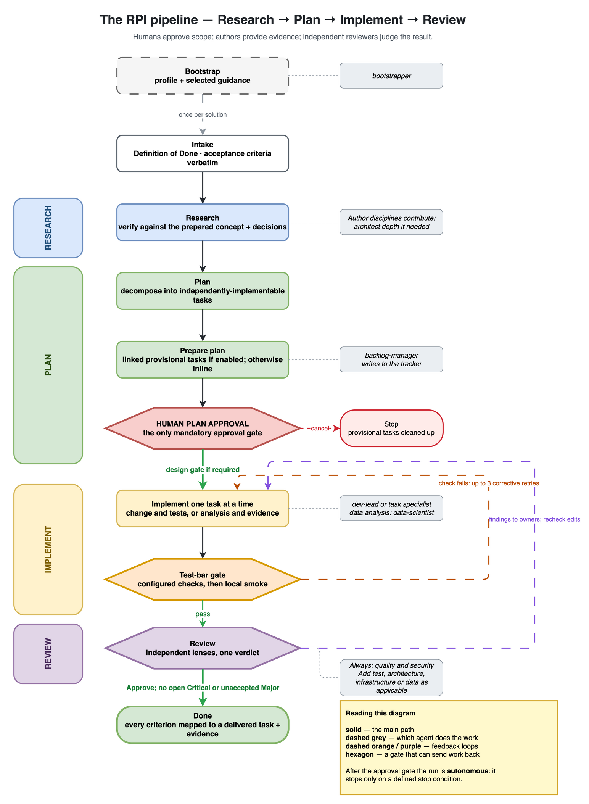

# Agile Agents

Agile Agents is the **Agentic Agile Harness**: the `agile-agents-core` GitHub
Copilot CLI plugin. It takes one prepared requirement and drives it through
**Research → Plan → Implement → Review**, with a human approval gate before
implementation and independent, read-only review before anything is called Done.

## Who it is for

- **Teams** that want agent-written changes to follow the same discipline as
  human ones: an agreed plan, tests written by the author, and independent review.
- **Maintainers** who already own architecture concepts, decision records,
  tracker conventions and CI commands, and want agents to conform to them rather
  than invent their own.

## What it is not

- Not an autonomous product owner. Requirements, concepts and decision records
  are prepared **by humans**; agents verify against them and escalate gaps.
- Not a technology catalog. Your solution owns framework, cloud and tracker
  guidance; the harness owns the process and role boundaries.
- Not a merge bot. Opening a pull request needs explicit approval; merging,
  closing, force-pushing and production deployment are human-only, always.

## Where to go next

| Section | Read it to… |
|---|---|
| [Concepts and roles](concepts.md) | Understand the supervisor, authors, reviewers and support roles. |
| [Plugin architecture](../codebase/ARCHITECTURE.md) and [agent and skill guide](../codebase/STRUCTURE.md) | See what core supplies, what your solution owns, and which capability to use. |
| [Capabilities and limitations](capabilities.md) | Know what is verified today and what is not. |
| [Getting started](../getting-started/index.md) | Install the plugin, bootstrap a repository and run a first requirement. |
| [Flow](../flow/index.md) | Follow a requirement through every stage and gate. |
| [Evaluation](../../eval/README.md) | See how the harness itself is measured, and the limits of that evidence. |

The [documentation hub](../README.md) and the decision records under
**Introduction → Reference → ADRs** remain the authoritative background material.
